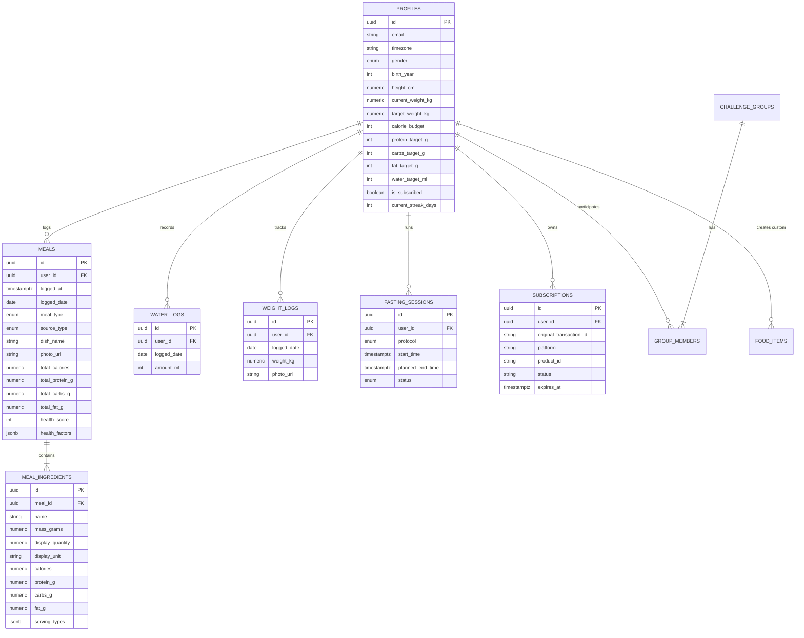
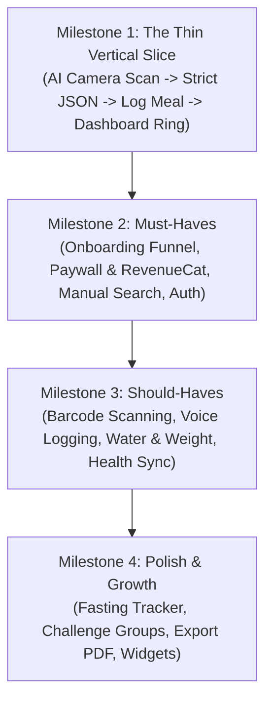

# Architecture: Cal AI Replica (a rebuild of Cal AI's core features)

Comprehensive engineering blueprint for rebuilding Cal AI's end-to-end nutrition tracking ecosystem: cross-platform mobile client, AI vision pipeline, PostgreSQL database with Row-Level Security, REST API routes, and subscription lifecycle.

---

## Stack

| layer | choice | why |
| --- | --- | --- |
| mobile app | Expo (React Native) + TypeScript | Cross-platform iOS and Android from one codebase, zero-config camera & native image compression, OTA updates via EAS. |
| styling | NativeWind (Tailwind CSS for React Native) | Rapid UI assembly matching design tokens across dark and light modes with unified responsive utility classes. |
| backend API | Next.js (App Router, TypeScript) | Serverless edge API routes, native TypeScript type sharing with mobile app, frictionless deployment on Vercel. |
| database | PostgreSQL on Supabase | Robust relational integrity, built-in Row-Level Security (RLS), instant connection pooling, and sub-millisecond query performance. |
| ORM | Drizzle ORM | Type-safe SQL dialect with zero runtime overhead; clean migrations and predictable query generation. |
| auth | Supabase Auth | Native Sign in with Apple, Google OAuth, and email magic links directly mapped to Postgres `auth.users`. |
| file storage | Supabase Storage (S3-compatible) | Secure bucket storage for meal photos and progress pictures with pre-signed URLs and automatic cache headers. |
| AI multimodal vision | Google Gemini 2.0 Flash Vision API | Sub-second vision reasoning, strict JSON schema output matching itemized ingredients and macro bounds, and low inference cost. |
| barcode & food data | OpenFoodFacts API + USDA FoodData Central | Free, comprehensive public food databases with global UPC coverage and standard reference nutritional breakdowns. |
| payments & subscriptions | RevenueCat + Apple StoreKit / Google Play Billing | Industry-standard mobile subscription infrastructure handling free trials, renewals, grace periods, and unified webhooks. |
| push notifications | Expo Push Notifications | Unified mobile notification gateway for meal logging reminders, streak alerts, and fasting window milestones. |
| background jobs | Supabase `pg_cron` + Inngest | Nightly streak evaluations, scheduled mealtime reminders, and periodic subscription status reconciliations. |
| hosting & CI/CD | Vercel (API) + Expo Application Services (EAS) | Instant zero-downtime serverless deployments and automated App Store / Play Store mobile release builds. |

---

## Schema

**Tables:** 10  
**Access rules:** PostgreSQL Row Level Security (RLS) on Supabase with authenticated user policies.  
Complete schema migration available in [`replica/schema.sql`](file:///c:/Users/ahmad/Documents/antigravity/delightful-meitner/replica/schema.sql).

### Entity Relationship Diagram

---

## API

All endpoints are hosted as Next.js Route Handlers (`/api/*`), protected via Supabase JWT Bearer Tokens in the `Authorization` header, and validated with Zod schemas.

### Route Catalog by Flow

| method path | does | who | input | output | flow |
| --- | --- | --- | --- | --- | --- |
| `POST /api/onboarding/profile` | Computes BMR/TDEE and saves initial goals | authenticated | `{ gender, birth_year, height_cm, weight_kg, target_weight_kg, activity_level, diet, pace }` | `{ profile_id, calorie_budget, macros: { protein, carbs, fat } }` | F01 Onboarding |
| `POST /api/meals/scan-image` | Decomposes compressed meal image with Gemini Vision AI | subscribed | Multipart form data: `image` (JPEG < 1MB) | Strict JSON: `{ dish_name, total_calories, macros, health_rating, ingredients: [...] }` | F02 AI Camera Scan |
| `POST /api/meals` | Persists confirmed meal and itemized ingredients | authenticated | `{ dish_name, meal_type, source_type, photo_url, ingredients: [...] }` | `{ meal_id, logged_at, updated_daily_summary }` | F02, F03, F04, F05, F06 |
| `GET /api/meals/today` | Fetches today's logged meals and remaining budget | authenticated | Query: `?date=YYYY-MM-DD` | `{ budget, consumed: { calories, protein, carbs, fat }, meals: [...] }` | F02, Dashboard |
| `GET /api/meals/:id` | Fetches details and ingredients for a specific meal | authenticated | Path: `id` (UUID) | `{ meal, ingredients: [...] }` | F02, Meal Detail |
| `PATCH /api/meals/:id` | Updates meal category or notes | authenticated | Path: `id`, Body: `{ meal_type, notes }` | `{ success: true, meal }` | F02, Meal Detail |
| `DELETE /api/meals/:id` | Deletes a logged meal (cascade deletes ingredients) | authenticated | Path: `id` (UUID) | `{ success: true, updated_daily_summary }` | F02, Meal Detail |
| `POST /api/meals/parse-text` | Extracts food items and macros from voice transcript/text | subscribed | `{ text_description: string }` | Structured meal preview matching `/scan-image` output | F03 Voice Logging |
| `GET /api/food/barcode/:code` | Queries OpenFoodFacts and cached database for barcode | authenticated | Path: `code` (string) | `{ name, brand, serving_size, calories, macros }` | F04 Barcode Scan |
| `POST /api/meals/scan-label` | OCR parses nutrition fact panel photo | subscribed | Multipart form data: `image` (JPEG) | `{ calories, protein, carbs, fat, serving_size }` | F05 Label OCR |
| `GET /api/food/search` | Full-text search for verified food items | authenticated | Query: `?q=query&limit=20` | `{ results: [ { id, name, calories, macros } ] }` | F06 Manual Search |
| `POST /api/food/custom` | Creates a reusable custom user food item | authenticated | `{ name, serving_amount, serving_unit, calories, macros }` | `{ item_id, name }` | F06 Custom Food |
| `POST /api/water` | Logs a water intake increment | authenticated | `{ amount_ml: integer, logged_date: string }` | `{ total_water_today_ml, progress_percentage }` | F07 Water Log |
| `GET /api/water/today` | Fetches today's accumulated hydration | authenticated | Query: `?date=YYYY-MM-DD` | `{ amount_ml, target_ml }` | F07 Water Log |
| `POST /api/weight` | Logs a scale weigh-in with optional photo | authenticated | `{ weight_kg: float, photo_url?: string, notes?: string }` | `{ weight_id, current_streak, delta_from_start }` | F08 Weight Tracking |
| `GET /api/weight/history` | Fetches historical weigh-ins for trend charts | authenticated | Query: `?range=30d` | `{ data_points: [ { date, weight_kg } ], target_goal }` | F08 Weight Tracking |
| `POST /api/fasting/start` | Starts intermittent fasting timer | authenticated | `{ protocol: '16_8' \| '18_6' \| '20_4' \| 'omad' }` | `{ session_id, start_time, planned_end_time }` | F09 Fasting Cycle |
| `POST /api/fasting/end` | Completes or cancels active fast | authenticated | Body: `{ session_id, status: 'completed' \| 'cancelled' }` | `{ duration_hours, fast_target_achieved }` | F09 Fasting Cycle |
| `GET /api/fasting/active` | Fetches current fasting session state | authenticated | None | `{ active_session: null \| session_object }` | F09 Fasting Cycle |
| `GET /api/analytics/weekly` | Aggregates 7-day intake, deficit, and macros | authenticated | Query: `?start_date=YYYY-MM-DD` | `{ days: [...], avg_calories, compliance_rate }` | Analytics |
| `POST /api/groups` | Creates a new social challenge group | authenticated | `{ name, description, icon_name, is_private }` | `{ group_id, invite_code }` | Community Groups |
| `POST /api/groups/join` | Joins a challenge group via invite code | authenticated | `{ invite_code: string }` | `{ group_id, name, member_count }` | Community Groups |
| `GET /api/groups/:id/leaderboard` | Fetches leaderboard ranked by streak and adherence | authenticated | Path: `id` | `{ group_name, members: [ { rank, display_name, streak } ] }` | Community Groups |
| `GET /api/subscriptions/entitlements` | Validates active subscription status | authenticated | None | `{ is_subscribed: boolean, tier: string, expires_at }` | S14 Paywall Gate |

### Webhooks & Background Jobs

- **Webhooks In:**
  - `POST /api/webhooks/revenuecat`: Receives subscription purchase, renewal, cancellation, and expiration events. Signed with RevenueCat authorization bearer token. Updates `profiles.is_subscribed` and logs to `subscriptions` table idempotently using `original_transaction_id`.
- **Scheduled Background Jobs:**
  - `job_streak_evaluator` (Daily at 00:05 UTC): Iterates active profiles, checks if a meal was logged on user's local yesterday date; increments `current_streak_days` or resets to 0.
  - `job_mealtime_reminders` (Every 15 minutes): Checks user notification settings against current local time; pushes reminder to log breakfast, lunch, or dinner via Expo Push.
  - `job_fasting_milestones` (Hourly): Triggers alerts when fasting users enter new metabolic stages (e.g. 12h Fat Burning, 16h Autophagy).

---

## The Parts That Bite

### 1. Time Zones and Localized "Day" Boundaries
- **Problem:** Nutrition tracking operates on "days" (e.g. today's 2,000 calorie budget), but databases record `timestamptz` in UTC. A user logging dinner at 11:15 PM in Los Angeles (UTC-7) would roll over into the next day in UTC, breaking daily totals and streak calculations.
- **Solution:** Every profile stores an IANA `timezone` string (e.g. `America/New_York`). All daily summaries compute the local date using Postgres `(logged_at at time zone profiles.timezone)::date`. The mobile client sends its local `date` parameter (`YYYY-MM-DD`) on all dashboard queries.

### 2. Idempotency & Webhook Replay Attacks
- **Problem:** RevenueCat retries webhooks on intermittent network blips. If a user renews or starts a trial, duplicate events could corrupt subscription history or trigger multiple promotional emails.
- **Solution:** Enforce unique constraint on `subscriptions(original_transaction_id)`. The webhook handler wraps writes in an `upsert` with an idempotency key cache in Redis / Postgres, returning HTTP 200 immediately for processed transaction IDs.

### 3. Multimodal Vision Hallucinations & Volume Estimation
- **Problem:** 2D phone camera photos do not convey physical mass or invisible ingredients (e.g. cooking oils, hidden butter, sugar in salad dressing). Pure LLM responses could hallucinate wild calorie counts.
- **Solution:** 
  1. The Gemini prompt is injected with strict calibration ranges (e.g. cooked chicken breast: ~165 kcal/100g, olive oil: ~120 kcal/tbsp).
  2. The prompt forces output into structured JSON matching `res/raw/scan_preview_cache_*.json`.
  3. The client UI exposes every detected item with editable gram weight and portion pickers (florets, slices, cups) so the user can adjust accuracy before saving.

### 4. Client-Side Image Compression Pipeline
- **Problem:** Modern smartphone cameras take 12MP–48MP photos (6MB–18MB JPEGs). Uploading raw files over mobile cellular data introduces 4–8 second latency and spikes serverless bandwidth costs.
- **Solution:** Use `expo-image-manipulator` to downscale photos on-device to max dimension 1080px and compress to JPEG (quality 0.75) prior to transmission. This reduces payload size to ~200KB–350KB, cutting total upload and inference turnaround to <1.8 seconds.

### 5. Offline-First Resilience
- **Problem:** Users frequently eat in basement restaurants or areas with weak reception.
- **Solution:** Cache today's dashboard and recent food items using WatermelonDB or Zustand + AsyncStorage. If an AI photo scan fails due to network timeout, save the captured photo in local queue with an "Uploading..." indicator and retry automatically when connectivity resumes.

---

## Build Order

### 1. Milestone 1: The Thin Vertical Slice (Core Loop)
- **Objective:** Prove the core loop end-to-end: camera photo capture -> multimodal vision parsing -> itemized ingredient review -> database persistence -> dashboard calorie ring update.
- **Screens:** `S15` (Dashboard), `S16` (Camera Viewfinder), `S17` (AI Scan Result), `S18` (Ingredient Edit Modal).
- **Tables:** `profiles`, `meals`, `meal_ingredients`.
- **Routes:** `POST /api/meals/scan-image`, `POST /api/meals`, `GET /api/meals/today`.

### 2. Milestone 2: Must-Haves (Funnel & Monetization)
- **Objective:** Build the high-converting onboarding survey, metabolic goal calculations, hard paywall gate, and fallback database search.
- **Screens:** `S01`–`S14` (Onboarding quiz & paywall), `S22` (Food Database Search), `S23` (Logged Meal Detail), `S29` (Settings).
- **Tables:** `food_items`, `subscriptions`.
- **Routes:** `POST /api/onboarding/profile`, `POST /api/webhooks/revenuecat`, `GET /api/food/search`, `DELETE /api/meals/:id`.

### 3. Milestone 3: Should-Haves (Multimodal Logging & Habit Tracking)
- **Objective:** Add convenience logging modalities and daily wellness tracking.
- **Screens:** `S19` (Barcode Scanner), `S20` (Label OCR), `S21` (Voice Logging), `S24` (Hydration), `S25` (Weight & Progress Photos), `S14` (Exit-Intent Discount Wheel).
- **Tables:** `water_logs`, `weight_logs`.
- **Routes:** `GET /api/food/barcode/:code`, `POST /api/meals/scan-label`, `POST /api/meals/parse-text`, `POST /api/water`, `POST /api/weight`.

### 4. Milestone 4: Polish, Retention & Growth
- **Objective:** Add social accountability, fasting cycles, and reporting.
- **Screens:** `S26` (Fasting Tracker), `S27` (Analytics & Trends), `S28` (Community Groups).
- **Tables:** `fasting_sessions`, `challenge_groups`, `group_members`.
- **Routes:** `POST /api/fasting/start`, `POST /api/fasting/end`, `GET /api/analytics/weekly`, `POST /api/groups/join`.
